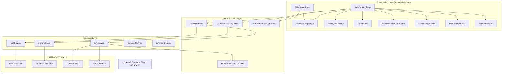

# CityOS Ride Architecture & Subsystem Design

## 1. High-Level Component Topology


## 2. Directory Architecture (`src/ride hub/ride/`)
```
src/ride hub/ride/
├── components/
│   ├── OlaMapComponent.jsx         # Bridge wrapper to MapLibre / OlaMapView
│   ├── RideTypeSelector.jsx        # Vehicle tier selector (Bike, Auto, Mini, Sedan)
│   ├── LocationSearch.jsx          # Autocomplete search & categorized destinations
│   ├── PickupSelector.jsx          # Pickup address selector & pin picker
│   ├── DestinationSelector.jsx     # Destination address selector
│   ├── FareEstimate.jsx            # Detailed fare & coupon display card
│   ├── DriverCard.jsx              # Captain identity, vehicle details & OTP card
│   ├── DriverMarker.jsx            # Dynamic MapLibre vehicle marker
│   ├── RideStatus.jsx              # Status banner showing active trip phase
│   ├── ETA.jsx                     # Arrival time countdown badge
│   ├── RideSummary.jsx             # Pre-booking route distance and time summary
│   ├── CancellationModal.jsx       # Cancellation reason confirmation dialog
│   ├── SafetyPanel.jsx             # Safety drawer with 112 call and share trip
│   ├── SOSButton.jsx               # Floating SOS button with siren generator
│   ├── PaymentModal.jsx            # Dynamic UPI QR, Card & Cash modal
│   ├── CouponModal.jsx             # Promo voucher application drawer
│   ├── InAppCallModal.jsx          # Masked VoIP call simulation
│   ├── ChatDrawer.jsx              # Canned chip in-app messaging
│   └── RideRatingModal.jsx         # 5-star review, feedback tags & driver tip
│
├── services/
│   ├── rideService.js              # State machine dispatcher & booking manager
│   ├── driverService.js            # Mock driver discovery, proximity & tracking
│   ├── locationService.js          # Browser GPS geolocation & reverse geocoding
│   ├── routingService.js           # Ola Maps directions & polyline decoder
│   ├── fareService.js              # CityOS fare engine calculation
│   └── paymentService.js           # Payment verification & QR generation
│
├── hooks/
│   ├── useRide.js                  # Primary ride hook binding state machine
│   ├── useDriverTracking.js        # Vehicle marker animation & GPS telemetry
│   ├── useCurrentLocation.js       # Geolocation manager with permission fallback
│   └── useRideStatus.js            # State-machine transition observer
│
├── state/
│   └── rideStore.js                # State machine & active ride session container
│
├── types/
│   └── ride.types.js               # JSDoc type definitions
│
├── constants/
│   └── ride.constants.js           # RIDE_STATUS, vehicle tiers, cancellation reasons
│
└── utils/
    ├── fareCalculator.js           # Mathematical pricing algorithm
    ├── distanceCalculator.js       # Haversine distance & ETA calculation
    └── rideValidation.js           # State transition & coordinate validation
```

## 3. Ola Maps Integration Pattern
- Vector maps rendered using `maplibre-gl` with Ola Maps styles.
- Routing requests use `https://api.olamaps.io/routing/v1/directions`.
- Autocomplete uses `https://api.olamaps.io/places/v1/autocomplete`.
- Marker animation runs in-memory without initiating routing calls on GPS telemetry updates.
