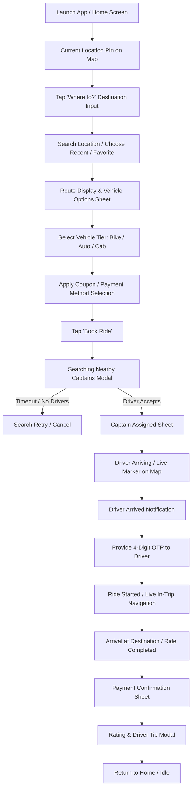

# Rapido Observable User Flows

## 1. End-to-End Primary Booking Journey

## 2. Pre-Booking Flows
1. **Location Resolution**:
   - Geolocation permission requested on first launch.
   - Map defaults to GPS position with a draggable center pin or address search box.
   - "Pickup Location" defaults to current reverse-geocoded landmark.
2. **Destination Search**:
   - Autocomplete place input with categorized suggestions (Recent trips, Saved Home/Work, Popular landmarks).
   - Distance and estimated travel time computed upon destination confirmation.
3. **Vehicle Tier Comparison**:
   - Bottom sheet displaying Bike, Auto, Cab Economy, and Cab Comfort.
   - For each tier: estimated price (crossed-out original price if discount applies), ETA to pickup (e.g. "3 mins away"), and vehicle thumbnail.
   - Coupon selection drawer showing available discount vouchers and cashback terms.

## 3. Active Ride & In-Transit Flows
1. **Captain Assignment**:
   - Driver card reveals: Captain photo, name, rating, vehicle make/model, license plate number, total platform trips.
   - 4-digit start OTP shown prominently at the top of the sheet.
2. **Communication**:
   - In-app masked VoIP call button.
   - In-app text chat with quick canned chips: *"I am at the gate"*, *"Please wait 2 mins"*, *"Where are you?"*.
3. **Trip Tracking & In-Trip Safety**:
   - Live marker updates along polyline.
   - Floating SOS button available at all times.
   - "Share Trip" option sending a live public Web tracking URL via WhatsApp/SMS to emergency contacts.

## 4. Post-Trip & Settlement Flow
1. **Fare Finalization**:
   - Base fare + waiting charges + toll fees (if applicable) minus applied coupon discount.
2. **Payment Collection**:
   - Auto-debit if UPI Autopay / Wallet selected; or dynamic UPI QR displayed for scan-and-pay; or Cash collection prompt.
3. **Feedback & Tip**:
   - 1 to 5 star rating.
   - Positive tags: "Safe Driving", "Clean Vehicle", "Polite Captain", "On Time".
   - Optional tip chips: ₹10, ₹20, ₹50.
